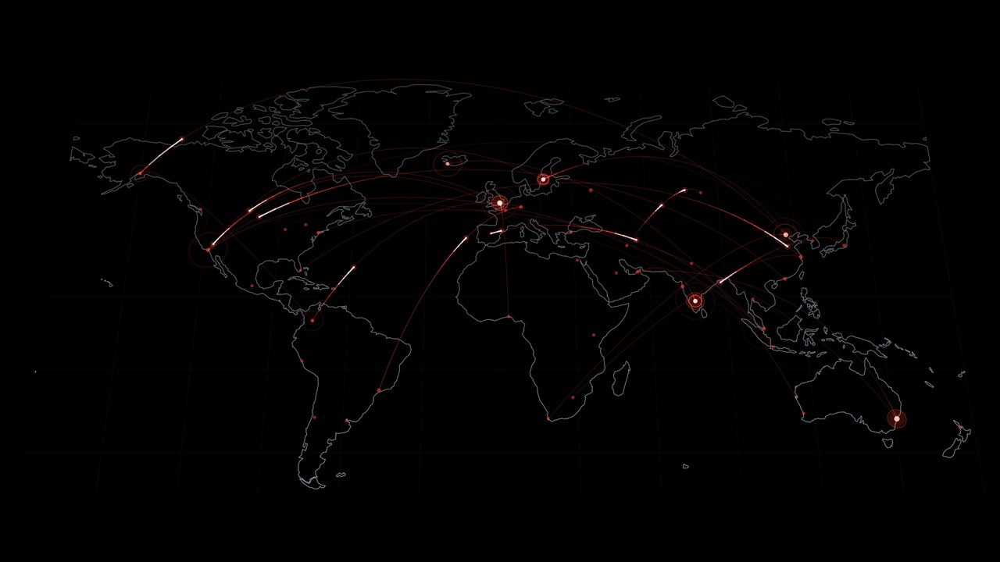
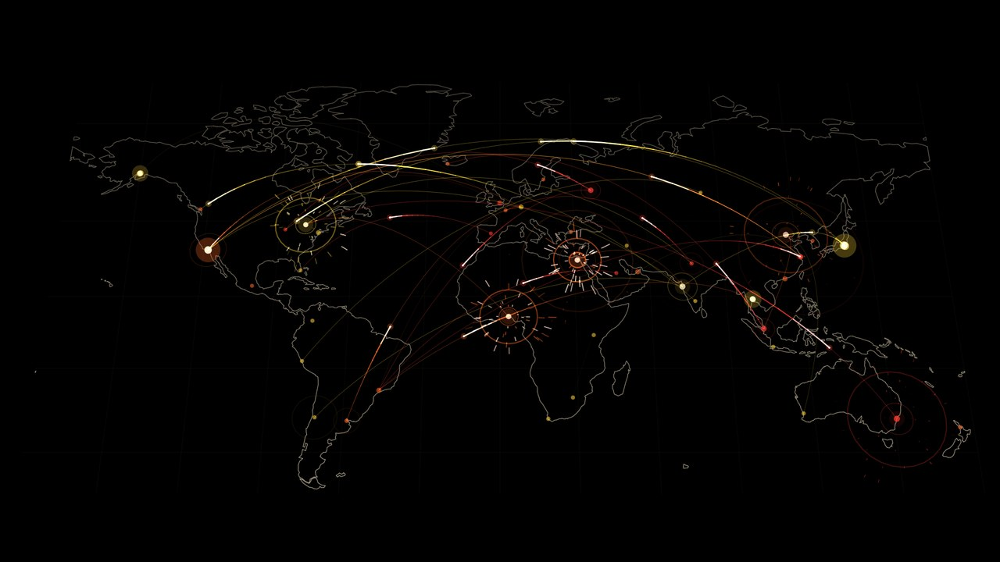
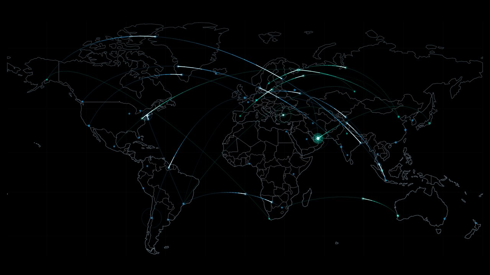
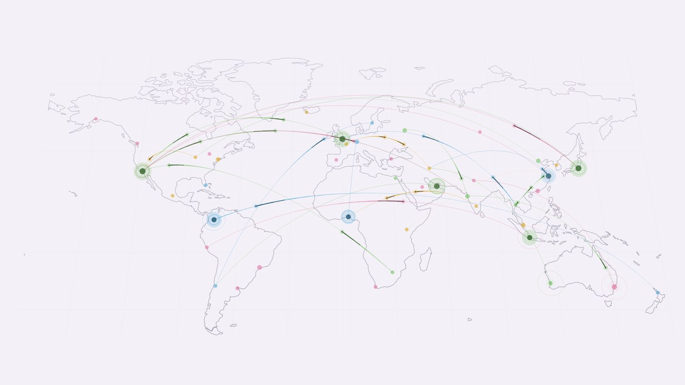
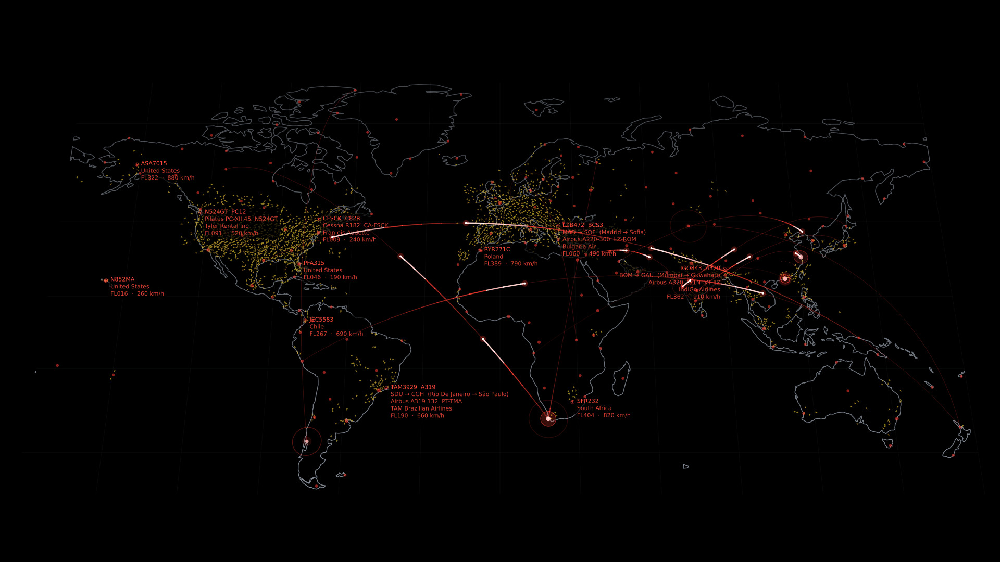
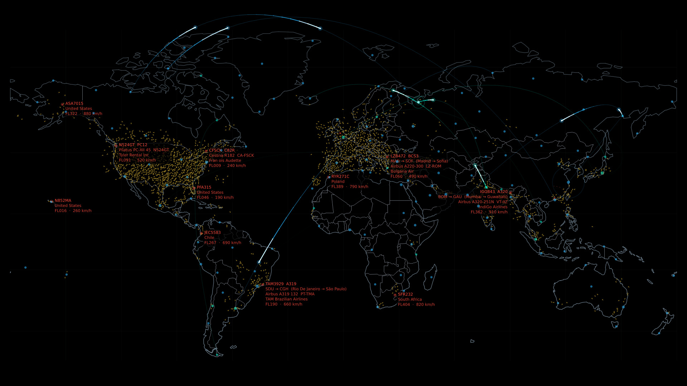

# World for KDE Plasma

A **Plasma 6 wallpaper** with a flat, perspective-tilted world map as line art and a simulated data stream: packets
fly along arcs between cities, the nodes pulse on arrival, and packets can blow up on impact. Written in QML.
**No build step, no browser, no extra plugin.**

| | |
|---|---|
|  |  |
|  |  |
|  |  |

## Features

- **Themes in collections** (also nested) with inheritance, like in Substrate: a collection holds default values, a
  theme only stores what it changes. 109 built-in themes show what is possible: nine looks (Classic, Ocean, Fire,
  Forest, Ice, Sunset, Pastel, Rainbow, Cobweb), each on OLED black and on a bright background, in the variants Calm and Explosions,
  flat (also Calm and Explosions) and Flights (tilted and flat, with live aircraft), plus one that follows the Plasma accent color.
- **A theme manager** with live preview, filter, drag and drop, context menus, duplicate, delete, per-value
  "inherited from …" markers and the arrow to take a value back.
- **A theme assistant** (own window, live preview): answer a few questions, let the rest be rolled, and create one or
  many themes at once.
- **Rotation:** tick any mix of collections and themes, they take turns every N seconds, in order or randomly, with a fade.
- **Themes are files:** your themes live in the theme folder (`~/.local/share/world-wallpaper/themes`), one JSON file
  per theme, one folder per collection. *Save* in the theme manager writes the file at once, and the desktop takes it over when
  you apply the settings. Share them, edit them, back them up.
- **Everything is a theme value:** colors (map, background, any number of line colors, rainbow, Plasma accent color),
  coast lines, **country borders**, number of cities, data density, speed, arc height, **explosions**, tilt (automatic, fixed or flat),
  map projection (Miller or plain), size and position.
- **Live aircraft** (off by default, needs the internet, no account or key): the aircraft of the whole world from
  OpenSky Network, renewed every 15 minutes, gliding to their new position after each update. Everything is a theme
  value (the built-in Flights collections switch it on): update interval, how many are shown (as far apart from each
  other as possible, so every region has some), colors (normal and labeled aircraft), size, labels with flight number,
  route, type, airline, altitude and speed (also switched off completely), dashed routes. Answers are cached on disk and
  shared by all screens; a service that refuses access is reported on the desktop. *Test connection* is in the theme
  manager.
- **Always fits:** the whole map is scaled to the screen with its 2:1 proportion, centered, also on ultrawide screens.
- **OLED friendly:** pure black backgrounds are a theme value, and a global setting shifts the picture a few pixels
  now and then to protect against burn-in.
- **Power aware:** limit the frame rate or pause on battery, while the screen is locked, or while a maximized or
  fullscreen window covers the desktop. Frame rate up to the refresh rate of the screen, resolution scale, and an
  overlay with frame rate and resource use.
- **Translations:** German, Spanish, French, Italian, Japanese, Brazilian Portuguese, Russian and Simplified Chinese, more as `po/<language>.po`.

## Requirements

- KDE Plasma 6 (the plugin is a `Plasma/Wallpaper` package, API 6.0)
- Qt 6.5 or newer (Quick, Controls)

## Install

```
./install.sh          # for the current user, no root needed
./install.sh -y       # the same, and restart Plasma without asking
./uninstall.sh
```

Then right-click the desktop → *Configure Desktop and Wallpaper* → *Wallpaper Type* → **World**.
Plasma only loads a new version after a restart: `systemctl --user restart plasma-plasmashell`.

`tools/make-package.sh` creates `dist/World-<version>.zip` for `kpackagetool6 -t Plasma/Wallpaper -i <zip>`
or the KDE Store (see `docs/kde-store.md`).

## Theme folder

Each collection is a folder, each theme a file with only the values it changes, `_collection.json` holds the defaults
of a collection:

```
~/.local/share/world-wallpaper/themes/
  Mine/_collection.json         { "BgColor": "#000000" }
  Mine/Neon.json                { "LineColors": ["#00ffd0", "#ff00aa"], "ExplosionChance": 30 }
```

The setting names are the ones in `contents/ui/params.js`. The files are the only place the themes are stored. The
folder is not watched in the background (like Substrate, no polling): the theme manager reads it when it opens, after
every save and on *Reload from theme folder* (for files you edit or copy in by hand), and the desktop reads it at the
start, after a pause and when you apply the settings (a save in the theme manager enables *Apply*).

## Aircraft: data sources, privacy and limits

- **OpenSky Network** (opensky-network.org) delivers the positions of all aircraft, **adsbdb.com** the route, airline and
  type of the labeled ones. Both are free and need no account. With aircraft switched on, requests to them leave your
  computer (nothing is sent about you besides what any web request contains, like your IP address); with aircraft off,
  the wallpaper makes no network requests at all.
- OpenSky allows about 100 requests of the whole world per day without an account, that is why the default is every
  15 minutes (10 minutes at the shortest).
- **Coverage:** OpenSky's data comes from volunteers' ADS-B receivers. Where there are few (Russia, large parts of Africa,
  the oceans) few aircraft show up, while the USA and Europe are dense. Limiting the number of aircraft picks them as far
  apart as possible, which evens that out a little, but cannot invent aircraft that are not in the data.

## Differences from Substrate

World is a QML wallpaper without a C++ plugin: it has no simulation, so no settings for cracks, sand or sparks, and
which tick or rotate (and the rest of the settings) are stored in the Plasma settings, the themes only in the theme folder.

## Map data

Coast lines and country borders: [Natural Earth](https://www.naturalearthdata.com/), public domain.

## License

GPL-3.0-or-later, see `LICENSE`.
